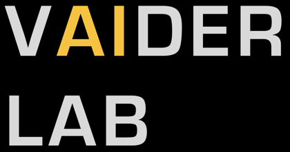

# Hit and Repair: Quick Guide

Open `index.html` in Chrome, Safari or Firefox (double-click), or use the GitHub Pages link in the README. Everything runs locally in the browser.

## For students
1. Pick a module tab, then a session (each session is a chapter).
2. Play the activities in any order. Quizzes, sorting, matching, sequencing and calculation drills are scored. Labs have challenges: set the sliders so the model shows the requested behaviour, then press Check.
3. Reach 70% of an activity's points to clear it (a tick). Replay to beat your best.
4. Do the pre-reading first. The games reinforce the session guides; they do not replace them.
5. Progress is saved in your own browser only. Another browser or device starts fresh.

## For the instructor: editing content
All course content is in `content.js` (modules, sessions, takeaways, questions). Add an activity to a session's `acts` list, for example:

    { id: 'm3s12x', type: 'quiz', title: 'New quiz', questions: [ Q('Question?', ['A','B','C','D'], 1, 'Why B is right') ] }

Types: `quiz`, `match`, `classify`, `sequence`, `gen` (random calculation drills), `case`, `lab`. Every `id` must be unique, because progress is stored by id. Labs live in `labs.js`; Module 2 review questions are in `m2q.js`.

## Publishing (GitHub Pages)
1. On github.com create a public repository named `RadBioHitAndRepair`.
2. Add the files (GitHub Desktop, or Add file > Upload files on the website). Include `index.html`, `.nojekyll`, `assets/` and the `.js` and `.css` files.
3. Settings > Pages > Source: Deploy from a branch > Branch `main` / `(root)` > Save.
4. After a minute the game is at https://pbasran.github.io/RadBioHitAndRepair/

## Tips
- Anyone can view a public repo's source, including quiz answers.
- Hard-reload (Shift-Reload) after publishing an update if the old version still shows.
