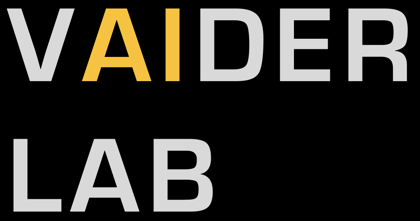

# Hit and Repair: Veterinary Radiobiology

**[Launch the game](https://pbasran.github.io/RadBioHitAndRepair/)** (GitHub Pages). An interactive study game for the Cornell CVM Veterinary Radiobiology course (VAIDER Lab). Four module tabs, one chapter per session. Everything runs in the browser; nothing is uploaded or collected.

**Open `index.html` in Chrome, Safari or Firefox to run it locally.**

## What it does
- **Module 1, Basic Radiobiology (Sessions 1-5):** time scales of damage, the DNA damage response, modes of cell death, a survival-curve lab, clonogenic assay arithmetic, LET and RBE, fetal and hereditary effects.
- **Module 2, Therapy Radiobiology I (Sessions 6-11):** a therapeutic-window lab, Poisson TCP, tumour kinetics, BED and EQD2, the four Rs, modified fractionation, the protraction factor g, normal-tissue effects.
- **Module 3, Therapy Radiobiology II (Sessions 12-17):** serial and parallel organs, a gEUD/LKB plan-evaluation lab, chemoradiation and the therapeutic ratio, a Bragg-peak lab, retreatment BED checks, whole-body exposure.
- **Module 4, Advanced Radiobiology (Sessions 18-20), draft:** oxygen effect and reoxygenation labs, hypoxia types.

Activity types: simulators with challenges, sorting, matching, sequencing, calculation drills with random numbers, short clinical cases, and quizzes. Points and ticks are saved in each student's own browser.

See [HOW_TO.md](HOW_TO.md) for use and for editing the content.

## Status
Teaching tool. Models are simplified and numbers are illustrative; nothing here is a clinical prescription. Module 4 is built from the course outline and standard textbook concepts, and will be revised when the session guides are written.

## License
MIT, see [LICENSE](LICENSE).
